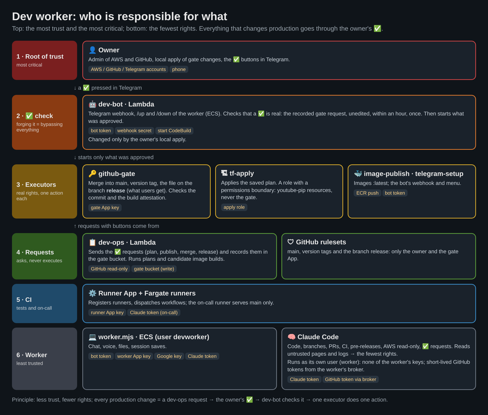

# AI development workflow: one owner, a phone, and Claude Code in the cloud

This repository is developed, tested, released and operated by one person from a Telegram chat, with Claude Code doing the hands-on work and the owner approving every step that changes something outside a branch. This page is the overview: what the pieces are, how a task flows through them, and why it is safe to run on a public repository. Details live in the linked documents.

- **[Dev worker](DEV_WORKER.md)**: Claude Code on an on-demand ECS task, talked to from Telegram.
- **[On-call](ONCALL.md)**: a daily e2e run, a YouTube experiment flag scan and a Claude investigation, reported to the same chat.
- **[Self-hosted runners](SELF_HOSTED_RUNNERS.md)**: CI on Fargate behind a fixed IP (Google bans GitHub-hosted runner IPs for the e2e test account).
- **[Infrastructure and images](DEV_WORKER.md#infrastructure-and-images)**: Terraform plans and image builds in CodeBuild, applied only after the owner's button.



Who holds which credential and who may change what: [DEV_WORKER.md, "Infrastructure and images"](DEV_WORKER.md#infrastructure-and-images).

## The idea

Most "Claude Code from your phone" setups bridge to a session on a laptop that has to stay on. Here everything runs in the owner's AWS account and nothing runs while nobody works:

- `/up` in Telegram starts a Fargate task with Claude Code (Claude Agent SDK); it restores the conversation, the working copy and its memory from S3 and continues where it stopped. It stops itself after 10 idle minutes (or on `/down`), saving everything first.
- The worker can do the whole development loop in the repository (branches, commits, PRs, CI, pre-releases; merges and releases through the gate) and **read** the project's AWS resources, but it holds no write credentials for AWS: infrastructure and image changes run in CodeBuild and wait for the owner's ✅ in the chat.
- A daily on-call job runs the e2e suite against live YouTube, scans YouTube's experiment flags for ones that could break the userscript, investigates failures with Claude and posts a report; the owner can answer "take it" and the worker continues from the report's artifacts.

## A task, end to end

```mermaid
sequenceDiagram
  autonumber
  participant O as Owner (Telegram, text or voice)
  participant B as dev-bot Lambda
  participant W as Dev worker (Fargate, Claude Code)
  participant G as GitHub (PR, CI on self-hosted runners)
  participant C as CodeBuild (tf-plan / tf-apply / image builds / github-gate)

  O->>B: "fix X" (the standard flow)
  B->>W: SQS FIFO (starts the task if it is down)
  W->>O: understanding of the task, questions as buttons, or a plan to approve
  W->>W: change, unit tests, narrowed e2e locally
  W->>G: branch + PR (CI runs the full e2e matrix)
  W->>C: dev-ops merge <pr> (once CI is green; facts from GitHub, not the worker's words)
  C->>O: 🔀 merge? ✅ / 🚫
  O->>B: ✅
  B->>C: github-gate
  C->>G: squash merge of the approved head (gate App)
  W->>C: dev-ops plan / dev-ops publish (after the merge, waited for in the background)
  C->>O: the plan (or image) with ✅ Apply / 🚫
  O->>B: ✅
  B->>C: tf-apply of exactly that plan / image-publish
  C->>O: result
```

For a product change "the standard" also means a pre-release (`vX.Y.Z-rc.N`) for the owner to install and check before the release ([PRERELEASE.md](PRERELEASE.md)), and the release flow of [CLAUDE.md](../CLAUDE.md).

## What the chat can do

| Area           | How                                                                                                                                                                                                                |
| -------------- | ------------------------------------------------------------------------------------------------------------------------------------------------------------------------------------------------------------------ |
| Conversation   | text, photos, files, voice (Gemini on Vertex AI, AWS Transcribe as fallback); answers as text and, optionally, voice (Google TTS)                                                                                  |
| Decisions      | Claude's questions as inline buttons; plan mode with "run / revise" buttons; permission prompts in `manual` / `auto` mode (`/mode`)                                                                                |
| Session        | `/model`, `/effort`, `/compact`, `/context`, `/background`, `/agents` (watch and talk to a running subagent), `/plans` (every plan ever made, with the owner's decision)                                           |
| Robustness     | saves after every answer and every 5 minutes of a long turn; background tasks cut off by a stop are offered for restoring with buttons; an idle watchdog warns about stray tasks                                   |
| Infrastructure | `dev-ops plan` → ✅ Apply; `dev-ops build` (candidate image from a branch, no approval); `dev-ops publish` → ✅; `dev-ops telegram` (bot webhook and menu) → ✅; `dev-ops merge <pr>` → ✅; `dev-ops release` → ✅ |
| Operations     | the daily on-call report (18:00 Warsaw, EventBridge Scheduler → `workflow_dispatch`); "Розбери онкол-прогін <run>" (CLAUDE.md) continues from its artifacts                                                        |

## Safety model

The repository is public, so the design assumes everyone can read every line of it. Nothing below depends on the setup being secret.

**Who can do what**

| Actor                    | Can                                                                                                                                                                   | Cannot                                                                                                                                                                                                                                           |
| ------------------------ | --------------------------------------------------------------------------------------------------------------------------------------------------------------------- | ------------------------------------------------------------------------------------------------------------------------------------------------------------------------------------------------------------------------------------------------ |
| Anyone on the internet   | read the repository, open issues / PRs                                                                                                                                | talk to the bot (dev-bot accepts only the owner's chat id and Telegram's webhook secret)                                                                                                                                                         |
| Dev worker (Claude Code) | push branches, open PRs, read `youtube-pip-*` resources and their logs, start `dev-ops` requests                                                                      | write any AWS resource, read secret values (explicit deny), forge the owner's ✅ (no webhook secret), merge into main or create version tags (its App is not a ruleset bypass actor), read the bot token or the App keys (a separate Linux user) |
| tf-plan (CodeBuild)      | plan `main` read-only, send the plan with buttons, record it in the ops bucket                                                                                        | apply anything                                                                                                                                                                                                                                   |
| tf-apply (CodeBuild)     | apply exactly the recorded plan the owner approved, within `youtube-pip-*`                                                                                            | touch the gate, create a role without the permissions boundary, read the bot's secrets, reach other projects                                                                                                                                     |
| The owner                | approve merges and releases with ✅ under the gate request and other outward-facing steps with "так", press ✅, apply gate changes locally with their own credentials |                                                                                                                                                                                                                                                  |

**The gate** ([details](DEV_WORKER.md#infrastructure-and-images)): only merged `main` is planned or published; dev-bot starts tf-apply only for the exact message tf-plan recorded (unedited, same buttons, within an hour, once). The real barrier is IAM, not the "no button" check: the apply role carries a permissions boundary with explicit denies on the gate's own roles, policies, Lambdas, CodeBuild projects and bucket, on removing the boundary and on reading the bot's secret and the gate App's secret, so even a malicious merged change and a pressed ✅ cannot widen the worker's or the apply role's rights. Merges and stable releases go the same way: dev-ops records the request, dev-bot starts github-gate only for that unedited message, and the gate App is the only identity besides the owner that may update `main`, create version tags or update the branch `release` (rulesets). Changes to the gate itself get no button and are applied by the owner locally.

**Untrusted input**: YouTube pages and bundles (read by the on-call), CI logs, web pages, and issues / PRs from others are data for Claude, never instructions (system prompts of the worker and the on-call). The on-call's Claude runs with read-only tools, no shell and no network; on-call secrets go only to `schedule` / `workflow_dispatch` runs of `main` of this repository, never to a PR's workflow.

**What still needs care**: the owner's local applies of gate changes (no boundary there), and reading the plans before pressing ✅ (the full plan comes as a file; the summary is generated by code from `main`).

## What stays manual

- A new AWS service in the stack: the gated apply role is extended (`project_apply` / `project_read`) and applied locally once.
- Gate changes: `terraform/dev_worker_ops.tf`, the worker's / dev-bot's / dev-ops' roles, the permissions boundary, `terraform/lambda/dev_bot.py`, `terraform/lambda/dev_ops.py`, `terraform/codebuild/github_gate.py`.
- Secret values (tokens, keys) in Secrets Manager.
- Settings outside AWS and the repository: the GitHub Apps' permissions (the worker's App, the gate App, the runner / on-call scheduler App), the rulesets and repository settings, Greasy Fork, the Google test account and the Claude subscription.

## State and memory

| S3 prefix (state bucket) | Content                                                                                           | Kept     |
| ------------------------ | ------------------------------------------------------------------------------------------------- | -------- |
| `transcripts/`           | session transcripts (Claude Code trims them after compactions: `CLAUDE_CODE_TRANSCRIPT_LOCAL_GC`) | for good |
| `state/`                 | working copy snapshot, session id, the owner's settings, background task records                  | for good |
| `memory/`, `plans/`      | Claude Code's auto memory, plans from plan mode with the owner's decisions                        | for good |
| `claude/`, `inbox/`      | subagent transcripts, tool results, voice uploads                                                 | a week   |

## Cost

Pay per use: the worker ≈ $0.10–0.12 per hour of work (2 vCPU / 4 GB on-demand Fargate plus a public IPv4), nothing while stopped; CodeBuild ≈ $0.005–0.01 per minute of a plan, apply or image build; Lambda, SQS, S3 and the scheduler stay within cents; voice is a few dollars a month at most. CI runners are Fargate Spot tasks per job ([SELF_HOSTED_RUNNERS.md](SELF_HOSTED_RUNNERS.md)). Claude usage counts against the Claude subscription.

## Reproducing it

Everything is in this repository: `terraform/` (the whole stack), `scripts/dev-worker/` (the worker), `scripts/oncall/` and `.github/workflows/e2e-manual.yml` (the on-call), and the setup steps in [DEV_WORKER.md](DEV_WORKER.md#setup-and-operating), [ONCALL.md](ONCALL.md) and [terraform/README.md](../terraform/README.md). The parts specific to this project are the e2e suite and the YouTube flag scan; the worker, the gate and the runners are generic.
