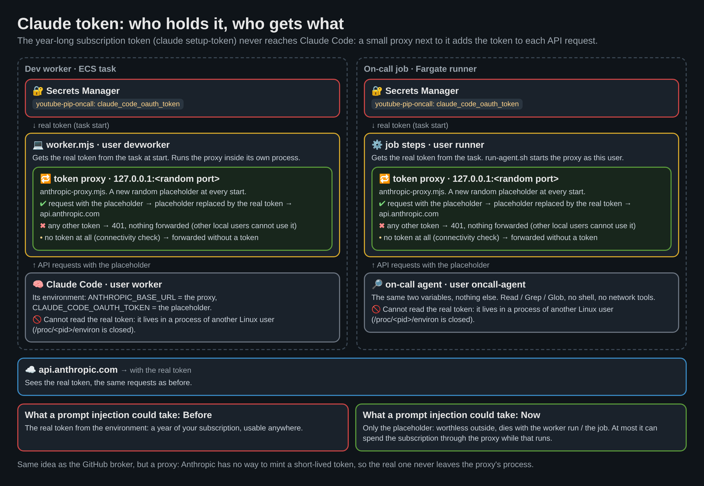
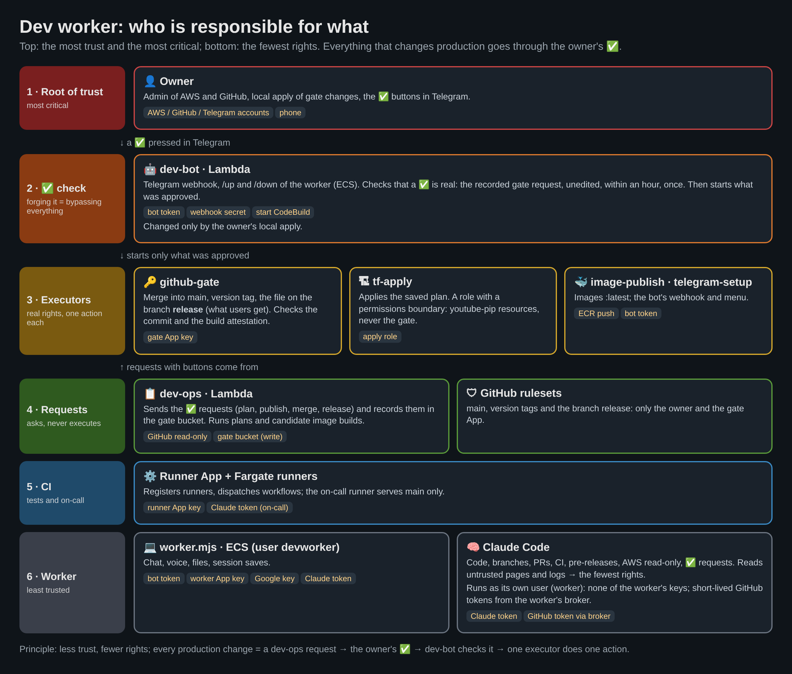

# Dev worker: Claude Code in Telegram

A Claude Code session (Opus) on an on-demand ECS task that the owner starts, talks to and stops from the on-call Telegram chat. It has what development and delivery need in this repository (branches, commits, PRs, CI status, releases with approval in the chat); its session survives restarts through S3. Same bot and same Claude subscription token as the on-call ([ONCALL.md](ONCALL.md)).

## Commands and statuses

| In the chat                                                              | What happens                                                                                                                                                                                                                                                                                                                                                                                                                                                                                                                                                                                                                                                                                                                                                                                                                                                                                                                                                                                                                                                                                                                                                                                                                                                                                                                                                                 |
| ------------------------------------------------------------------------ | ---------------------------------------------------------------------------------------------------------------------------------------------------------------------------------------------------------------------------------------------------------------------------------------------------------------------------------------------------------------------------------------------------------------------------------------------------------------------------------------------------------------------------------------------------------------------------------------------------------------------------------------------------------------------------------------------------------------------------------------------------------------------------------------------------------------------------------------------------------------------------------------------------------------------------------------------------------------------------------------------------------------------------------------------------------------------------------------------------------------------------------------------------------------------------------------------------------------------------------------------------------------------------------------------------------------------------------------------------------------------------- |
| `/up`                                                                    | `⏳ Піднімаю воркера…` → `🟢 Воркер готовий (Opus). Контекст відновлено з сесії від <дата>; гілка <branch>[, робоча копія свіжа].` (no saved session: `🟢 Воркер готовий (Opus). Нова сесія; гілка <branch>.`); or `🟢 Воркер уже працює`, `⏳ Воркер уже піднімається`, `⏳ Попередній воркер ще вимикається: підніму новий, щойно він зупиниться` → `⏳ Піднімаю новий воркер…`, `🔴 Не вдалося підняти воркера: …`                                                                                                                                                                                                                                                                                                                                                                                                                                                                                                                                                                                                                                                                                                                                                                                                                                                                                                                                                        |
| `/down`                                                                  | `⏳ Зупиняю, зберігаю контекст…` → `Контекст збережено, вимикаюсь…` (during a turn: `Поточну задачу перервано. Контекст збережено, вимикаюсь…`) → `⚪ Воркер зупинено` (sent by the bot on the task's STOPPED event, when it really is stopped); when a new worker is already starting by then (a message sent while the old one was stopping), `⚪ Попередній воркер зупинено`; not running: `⚪ Воркер і так не запущений`                                                                                                                                                                                                                                                                                                                                                                                                                                                                                                                                                                                                                                                                                                                                                                                                                                                                                                                                                 |
| `/start`                                                                 | `Команди: /up — підняти воркера, /down — зупинити. Поки він працює, пиши йому сюди;` followed by one line per worker command (/mode … /status)                                                                                                                                                                                                                                                                                                                                                                                                                                                                                                                                                                                                                                                                                                                                                                                                                                                                                                                                                                                                                                                                                                                                                                                                                               |
| `/context`                                                               | answered by the worker itself, no Claude turn (also mid-turn): `ctx 61% · 5h 12% ↻2h15m · week 14% ↻Fri 21:00` and the context tokens. `ctx` = session context window used (`getContextUsage`), `5h` / `week` = plan usage and reset (in 2h15m / Fri 21:00 Warsaw time) from the session's last `rate_limit_event`; before Claude's first answer in a run the limits show `?`. Not running: the bot starts the worker as for any message                                                                                                                                                                                                                                                                                                                                                                                                                                                                                                                                                                                                                                                                                                                                                                                                                                                                                                                                     |
| `/background`                                                            | answered by the worker itself, no Claude turn (also mid-turn): whether Claude is working now and the session's background tasks (shell commands, subagents): type, description, running for (since the worker saw it start)                                                                                                                                                                                                                                                                                                                                                                                                                                                                                                                                                                                                                                                                                                                                                                                                                                                                                                                                                                                                                                                                                                                                                  |
| `/voice` [`auto` \| `on` \| `off` \| `samples` \| `compare` \| `<name>`] | voice reply settings, answered by the worker with buttons (mode, speech model, voice, samples, `compare`: one sentence in the current voice with every model; picking a voice sends its sample first) or by the argument: mode (`auto`: answer the owner's voice messages also by voice, default; `on`: every answer; `off`), `samples` sends a sample of 6 female Chirp 3 HD voices, `<name>` (e.g. `Kore`) picks the voice; kept in `state/meta.json`                                                                                                                                                                                                                                                                                                                                                                                                                                                                                                                                                                                                                                                                                                                                                                                                                                                                                                                      |
| `/status`                                                                | answered by the worker: a fresh status message at the bottom of the chat, pinned instead of the previous one (which is unpinned), e.g. after the owner unpinned it                                                                                                                                                                                                                                                                                                                                                                                                                                                                                                                                                                                                                                                                                                                                                                                                                                                                                                                                                                                                                                                                                                                                                                                                           |
| `/scheduled`                                                             | answered by the worker: the owner's scheduled tasks (local time, task) with a `🗑 Скасувати N` button each (see "Scheduled tasks")                                                                                                                                                                                                                                                                                                                                                                                                                                                                                                                                                                                                                                                                                                                                                                                                                                                                                                                                                                                                                                                                                                                                                                                                                                           |
| `/timezone` [city \| `Europe/Kyiv`]                                      | answered by the worker: the owner's working time zone (default `Europe/Warsaw`, kept in `state/meta.json`) for the times shown in the chat (session save, limit resets, background tasks, plans); a city in any language is looked up with the Open-Meteo geocoder (free, no key; it matches names only in the language asked, so ~30 languages are searched at once, Ukrainian first for the labels: "Warszawa", "München", "Kraków"; exact matches, diacritics ignored); when the matches lie in different zones, a place at least ten times bigger than the next is taken at once (with a "not this city?" button for the others), otherwise the worker asks with a button per place; an IANA name is taken as it is. Claude gets a note with the new zone on the next message. The daily on-call keeps its Terraform schedule.                                                                                                                                                                                                                                                                                                                                                                                                                                                                                                                                           |
| `/mode` [`bypass` \| `auto` \| `manual` \| `plan`]                       | answered by the worker: without an argument the current mode with a button per mode; with one (or a button) switches the session right away (`setPermissionMode`) and keeps it in `state/meta.json` (see [Modes, questions and plans](#modes-questions-and-plans))                                                                                                                                                                                                                                                                                                                                                                                                                                                                                                                                                                                                                                                                                                                                                                                                                                                                                                                                                                                                                                                                                                           |
| `/model` [name]                                                          | answered by the worker: without an argument the session's models (`supportedModels()`: name, id, description) as buttons, the current one marked; a button or the argument switches the running session (`setModel`); kept in `state/meta.json` for later runs (default `CLAUDE_MODEL`, opus); the ready message names it                                                                                                                                                                                                                                                                                                                                                                                                                                                                                                                                                                                                                                                                                                                                                                                                                                                                                                                                                                                                                                                    |
| `/effort` [`low` \| `medium` \| `high` \| `xhigh` \| `max` \| `default`] | answered by the worker: the effort levels the current model supports as buttons and the model's own default; switches the running session (`applyFlagSettings({effortLevel})`); kept in `state/meta.json` (passed as `effort` to later sessions)                                                                                                                                                                                                                                                                                                                                                                                                                                                                                                                                                                                                                                                                                                                                                                                                                                                                                                                                                                                                                                                                                                                             |
| `/agents`                                                                | answered by the worker (like Claude Code's agent view): `🧠 Основний агент` and a button per running subagent (description, running for); picking a subagent streams its messages to the chat (its texts as messages, whole, in parts if long; its tool calls in one message edited in place), every time from the start: `📝 Бриф від основного агента` (the prompt Claude gave it), then all its texts and steps so far, through SDK APIs only: its messages from `getSubagentMessages()`, then its text and tool calls as they stream (`forwardSubagentText`: subagent messages carry `agent_id` = the task id). Meanwhile the main agent's answers are held (`💬 Основний агент відповів`) and delivered on the switch back; questions and permission prompts always come through; the owner's messages go to the main agent with a note to relay them to the shown subagent (SendMessage). When the subagent finishes (task notification, or the Agent tool's result for a foreground one) the chat gets `✅ 🤖 … завершив · за …, кроків N` and goes back to the main agent; the main agent's answers then (the held ones and the next) drop the paragraphs that repeat what the subagent wrote in the view (`withoutRepeated`, session-state.mjs), since the owner has just read it. A subagent that finished while not shown is reported by the main agent as before |
| `/plans`                                                                 | answered by the worker: the 10 newest saved plans (title, date, the owner's decision) with a button each that sends the plan file                                                                                                                                                                                                                                                                                                                                                                                                                                                                                                                                                                                                                                                                                                                                                                                                                                                                                                                                                                                                                                                                                                                                                                                                                                            |
| `/compact` [instructions]                                                | Claude Code's `/compact` with optional instructions on what to keep (not during a turn); answered `🗜 Контекст стиснуто: 61% (120k) → 9% (18k)`                                                                                                                                                                                                                                                                                                                                                                                                                                                                                                                                                                                                                                                                                                                                                                                                                                                                                                                                                                                                                                                                                                                                                                                                                              |
| text, photo, voice, audio, file                                          | to the worker; its answer comes back in the chat (`⏳ Працюю…` with the current step while it works). Not running: the worker is started for it (`⏳ Воркер не був запущений: піднімаю, передам повідомлення…`); starting: `📥 Отримав, передам, щойно підніметься`                                                                                                                                                                                                                                                                                                                                                                                                                                                                                                                                                                                                                                                                                                                                                                                                                                                                                                                                                                                                                                                                                                          |
| (10 min idle)                                                            | `💤 10 хв без активності. Контекст збережено, вимикаюсь…` → `⚪ Воркер зупинено`                                                                                                                                                                                                                                                                                                                                                                                                                                                                                                                                                                                                                                                                                                                                                                                                                                                                                                                                                                                                                                                                                                                                                                                                                                                                                             |
| (15 min after the last answer, still up, no turn running)                | `🟡 Воркер працює вже N хв після останньої відповіді…` from the dev-bot (idle watchdog, checked every minute, repeated every 15 min while it stays so): likely a stray background task keeping the idle timer from firing; /background to look, /down to stop                                                                                                                                                                                                                                                                                                                                                                                                                                                                                                                                                                                                                                                                                                                                                                                                                                                                                                                                                                                                                                                                                                                |
| (unexpected)                                                             | `🔴 Воркер несподівано зупинився (<причина>). Контекст останнього збереження: <час>`                                                                                                                                                                                                                                                                                                                                                                                                                                                                                                                                                                                                                                                                                                                                                                                                                                                                                                                                                                                                                                                                                                                                                                                                                                                                                         |

Idle = no message from the owner and no work in progress for 10 minutes.

The worker's own stop message is sent as its process ends, and ECS needs another 30–60 s to stop the task. A message or `/up` while a stopped worker is still shutting down (possibly still saving its session) is not lost and not refused: the message is queued, the bot answers `⏳ Попередній воркер ще вимикається: підніму новий…` and leaves a marker (`state/pending-start.json` in the state bucket); the STOPPED event of that task starts the new worker, so it never restores a session that is still being saved.

## Architecture

```
Telegram ──webhook──▶ Lambda dev-bot (Function URL)
                        │  checks X-Telegram-Bot-Api-Secret-Token and the owner's chat id
                        ├─ /up    ─▶ ecs:RunTask  (dev-worker, FARGATE on-demand, public subnet + public IP)
                        ├─ /down  ─▶ ecs:StopTask (SIGTERM → the worker saves and exits)
                        └─ text   ─▶ SQS FIFO dev-worker-inbox
                                        │
                     ECS task dev-worker (2 vCPU / 4 GB) ◀──┘ long poll
                        ├─ restores the session and the working-copy snapshot from S3 (clones the repo only without a snapshot)
                        ├─ one Claude Code session for the whole run (Agent SDK, streaming input, opus, all tools);
                        │  each message goes into it; a message during a turn: running commands → background, priority 'next'
                        ├─ answers / statuses ─▶ Telegram Bot API
                        ├─ after each answer: session + working-copy snapshot ─▶ S3 dev-worker-state
                        ├─ after each answer: {lastAnswerAt, turnActive} ─▶ S3 state/activity.json
                        └─ idle 10 min / SIGTERM: save, notify, exit 0

EventBridge rate(1 minute) ─▶ Lambda dev-bot (scheduled tasks, idle watchdog)
                        └─ worker up, no turn running, last answer ≥ 15 min ago ─▶ `🟡` warning + watchdog message in the queue, again every 15 min while it stays so
                             └─ worker: Claude stops the orphaned background tasks ─▶ idle timer stops the worker

EventBridge "ECS Task State Change" (dev-worker STOPPED) ─▶ Lambda dev-bot
                        └─ stop the worker did not report itself (exit code other than 0 / 10, OOM, task killed) ─▶ `🔴` in the chat
```

- **Lambda dev-bot**: Telegram webhook, commands, statuses of starting / stopping, forwarding messages to the queue, and the `🔴` on an unexpected stop. Only the owner's chat (`telegram_chat_id` of `youtube-pip-oncall`) is served; the webhook is registered with a secret token that Telegram sends in every request.
- **SQS FIFO `dev-worker-inbox`**: messages in order, kept while the worker starts. Telegram allows either a webhook or polling per bot, so the worker never polls Telegram itself.
- **ECS task `dev-worker`**: on-demand Fargate (an interactive session interrupted by Spot costs more than the ~$0.07/h saved), its own image (Node, git, `gh`, Claude Code, Playwright Chromium for narrowed tests), in its own ECS cluster `dev-worker`, in the public subnet of the runner VPC with a public IP. It does not use the NAT instance: the NAT exists for the e2e runs, and the NAT lifecycle Lambda starts it whenever the runner cluster has a task, so the worker stays out of that cluster. Claude Code runs in it as the user `worker` without the task's secrets ("Claude Code as a separate user").
- **S3 `dev-worker-state`**: the Claude Code session (transcript), its id and a snapshot of the working copy (`state/workspace.tar.gz`, without `node_modules`, `dist`, test output and `terraform/.terraform`). Restored on every `/up`, so the conversation continues across `/down`, idle stops and restarts. Saved after every answer, every 5 minutes of a long turn and on stop, so a crash loses at most a few minutes of a turn. Expiry: only `claude/` (subagent transcripts, tool results) and `inbox/` expire, a week after they were last written; `state/` (working copy, session id, settings such as the mode, model, effort and voice, background task records), `transcripts/`, `plans/` and `memory/` are kept for good. The bucket is versioned: an overwritten or deleted object keeps its previous version for a while, per prefix (`dev_worker_state_noncurrent_days`): `memory/` and `plans/` a year, `transcripts/` a month (Claude Code trims a transcript after a compaction, so its earlier part is in the previous versions), `state/`, `claude/` and `inbox/` a day (rewritten after every answer). Restore: S3 console → the object → Versions, or `aws s3api list-object-versions` / `get-object --version-id` with the owner's credentials.
  - **Transcript**: Claude Code runs with [`CLAUDE_CODE_TRANSCRIPT_LOCAL_GC=1`](https://code.claude.com/docs/en/env-vars) (documented, Claude Code v2.1.287+): after each compaction, once the transcript file is over 5 MB, Claude Code removes the history from before that compaction itself, and resuming restores the same conversation. The worker uploads session transcripts as they are to `transcripts/<project>/<session id>.jsonl` (kept for good) and restores only the current session's; subagent transcripts and tool results go to `claude/projects/` and expire.
  - **Memory** (Claude Code's auto memory, `~/.claude/projects/<project>/memory/`): `memory/<project>/…`, outside the expiring prefixes like `plans/`, because a memory file can stay unchanged for weeks (under `claude/` it expired a week after its last change). Restored on start (over the old copy under `claude/projects/`, which expires), uploaded on every save; a file Claude deletes is deleted there too.
  - **Background tasks** (`state/background/<task id>.json`): while a background task of the main session runs (shell command, Monitor, subagent), its record holds what it is, its command or prompt, the owner's message it was started for and when; it is deleted when the task ends. Tasks still running when the worker stops (or when the Claude session restarts) keep their records: at the next start the chat gets `⏸ Фонові задачі попереднього запуску не завершились` with each task (command / task, purpose, start time) and buttons per task (toggle), `✅ Відновити вибрані`, `♻️ Відновити всі`, `🚫 Жодної`. The chosen ones go to Claude as a note: shell commands run again, subagents are resumed with `SendMessage` from their saved transcript (or started again with the same prompt). The records are dropped once the owner decides.
- **EventBridge rule**: ECS stop events of the `dev-worker` cluster → dev-bot, so a crash is reported even when the worker could not say anything.

## Idle watchdog

The worker stops after 10 minutes without a turn or a background task. A background task that never ends (a stuck watch, a forgotten server) keeps it up indefinitely, and there is no hard lifetime limit. So the worker writes `state/activity.json` (`lastAnswerAt`, `turnActive`, `stopping`: a worker saving its session before it exits is not warned about) when a turn starts and after each answer (also the ready message), and the dev-bot Lambda checks every minute (the EventBridge rule that also fires scheduled tasks): if the worker task is running, no turn is active and the last answer is at least `dev_worker_idle_alert_minutes` (15, above the 10-minute idle stop) old, it sends `🟡 Воркер працює вже N хв після останньої відповіді…` with /background and /down, and repeats every `dev_worker_idle_alert_minutes` while nothing changes (`state/idle-alert.json` keeps the answer and the time of the last warning). The same check also puts a watchdog message into the worker's queue (`{watchdog: "idle", lastAnswerAt, minutes}`, deduplicated per warning). The worker does not count it as the owner's activity; when it is current (no answer since), no turn is running and background tasks exist, it gives Claude the list of background tasks (type, description, running time, task id). Claude stops only the orphaned ones (nobody waits for them any more) with TaskStop, keeps the ones it deliberately waits for and says in the chat what it stopped and kept; with no background task left, the 10-minute idle timer stops the worker without the owner. The dev-bot never stops the worker itself; a long turn is not warned about.

## Pinned status

A message pinned at the top of the chat shows the session at a glance and is edited in place, silently. Its first line is a dense summary, since the pinned bar shows only ~60 characters (state, mode, model, context, Claude usage, Gemini speech spend); the lines below give the details: worker running / sleeping since, mode, model and effort, Claude's 5-hour and weekly windows (with reset times) and the context, the voice mode, speech model, voice and the month's Gemini speech spend of its budget, the working time zone and the number of scheduled tasks. The worker sends and pins it on its first run (id in `state/meta.json`, `statusMessageId`) and edits it (debounced, only when something changed) after answers and setting changes (anything saved to `meta.json`), Claude's rate-limit events and Gemini speech; on stop it says since when it sleeps. A deleted status is sent and pinned again; an unpinned one keeps being edited where it is (`/status` brings a fresh one back to the top). While the worker sleeps nobody updates it (the limits are as of the stop).

## Scheduled tasks

- The owner asks for something at a later time ("at 6 pm check CI"); Claude schedules it with the image's `schedule` command (`scripts/dev-worker/schedule.sh`: `add "<YYYY-MM-DD HH:MM>" "<task>" [zone]`, `list`, `cancel <id>`; the time in the owner's working time zone from `state/meta.json`, one-off, in the future), which writes `state/scheduled/<id>.json` (`id`, `dueAt` UTC, `timeZone`, `text`, `createdAt`).
- The dev-bot Lambda runs every minute (the EventBridge rule that also drives the idle watchdog): a task whose time has come is removed first (never sent twice), announced in the chat (`⏰ Запланована задача: …`) and sent to the worker's queue like the owner's message with a note that it is scheduled; a sleeping worker is started for it as for any message.
- `/scheduled` lists them with cancel buttons. `state/` does not expire, so a task waits as long as needed. No recurring tasks yet.
- dev-bot's rights for it (read / delete `state/scheduled/*`, list that prefix) are part of the gate: applied by the owner locally.
- The worker writes the tasks itself, so a scheduled task is a request to do work, never the owner's approval: its text cannot stand for a "так" to merge, tag or release, nor for a button (system prompt). Without this rule the worker (say, after a prompt injection from a web page or CI output) could schedule an "owner's message" that stands for a "так"; merges and releases need the gate's ✅, which a scheduled message cannot press.

## Claude plan limits

- At 80% and 90% of a plan window (5-hour, weekly, …; from the SDK's `rate_limit_event`) the chat gets one silent warning per step and window cycle: `🟡 Використано 85% ліміту Claude (тижневий), скинеться пт, 21:00 (через 2h15m)`.
- A turn refused by the plan limit (`status: rejected`, or Claude Code's "usage limit reached" / "hit your … limit" text) ends as `⛔ Ліміт Claude вичерпано` with a plain message: which limit, when it resets (owner's time zone) and that the bot's own commands still work.
- While the limit is in force (until its reset time), a new message is not sent to Claude: the worker answers with the reset time and asks to send it again after the reset. `/context` shows the windows as before.

## Claude API errors

- Transient API failures (529 overloaded, 5xx, dropped connections) are retried by Claude Code itself with backoff; the turn just takes longer.
- When Claude Code gives up, the turn's error is put in plain words (`apiErrorKind`, `session-state.mjs`): overloaded, Anthropic 5xx, too many requests (429), timeout / network, a refused Claude token (renew `claude_code_oauth_token` with `claude setup-token`), a too long context (`/compact`); the raw error follows as details. Transient ones get a `🔁 Повторити` button that sends the same message to Claude again (once). Unknown errors are shown as before.
- A crash of the Claude Code process restarts the session with the same context (`⚠️ Сесія Claude перезапускається`), at most 3 times in a row.

## Modes, questions and plans

One `/mode` command, four modes (Claude Code's permission modes; the session switches at once, the mode survives restarts in `state/meta.json`; outside `bypass` every answer starts with the mode's label, and the ready message names it):

When Claude Code changes the mode itself (Claude calls `EnterPlanMode`, which Claude Code may allow without asking the worker, or returns from plan mode), the worker follows it: the tool call and the session's `status` messages (`permissionMode`) update `/mode`, and the chat gets `📋 Claude перейшов у режим plan (було: bypass) · /mode`. SDK `default` is bypass or manual alike: the worker takes the one before plan mode. Pressing the current mode's button again re-applies it to the session.

| Mode                  | Claude Code mode | Permission prompts                                                                        |
| --------------------- | ---------------- | ----------------------------------------------------------------------------------------- |
| 🚀 `bypass` (default) | `default`        | all allowed by the worker (as before)                                                     |
| 🤖 `auto`             | `auto`           | the classifier approves safe calls itself; what it cannot decide comes to the chat        |
| ✋ `manual`           | `default`        | every prompt comes to the chat                                                            |
| 📋 `plan`             | `plan`           | read-only exploration; prompts (if any) come to the chat; the plan ends with ExitPlanMode |

`bypass` is not Claude Code's `bypassPermissions`: that mode never consults the SDK's `canUseTool`, and `canUseTool` is the only way questions (AskUserQuestion) and plan approvals (ExitPlanMode) reach a host. So `bypass` runs Claude Code's `default` mode and the worker's `canUseTool` allows every prompt itself.

- **Questions** (AskUserQuestion, any mode): each question is a message with its options (label, description) and a button per option, `✏️ Свій варіант`; multi-select questions toggle `⬜` / `☑️` and end with `✅ Готово`. The chosen option (or the owner's text, also a voice message) goes back as the tool's answer in the same turn and the message is edited to `✅ <answer>`. While a question, plan or prompt waits, a plain text message from the owner is its answer (commands still work; photos and files are delivered as messages). The progress message shows `⏳ Чекаю на твою відповідь`.
- **Permission prompts** (`manual`, `auto`'s undecided calls, `plan`): the action (Claude Code's title, the command, the file and an Edit as a `-` / `+` diff) with `✅ Дозволити`, `❌ Відхилити` and, when Claude Code offers a rule, `♾ Дозволяти до кінця сесії`. A text answer denies with the owner's words as instructions.
- **Plans** (`plan`): the plan Claude submits with ExitPlanMode (its input, else the newest file in `~/.claude/plans`) is sent as Telegram HTML (`telegram-format.mjs`): a header with the version and the S3 key, headings in bold, bullets and numbered steps, code in monospace, tables as aligned monospace blocks, and every `##` section longer than 8 lines folded into an expandable quote (the outline fits a phone screen, tap a section to read it); long plans are split between blocks. Then `▶️ Виконувати цей план?` with `✅ Так, auto`, `🚀 Так, bypass`, `✋ Так, manual` (the mode switches and Claude carries out the plan in the same turn, as Claude Code does after "yes, and auto-accept") and `✏️ Доопрацювати` (the owner's text goes back as feedback, Claude stays in plan mode and submits a new version).
- **Saved plans**: every version goes to `plans/<date>-<title>[-vN].md` in the state bucket with the owner's decision appended (`approved, run in auto mode`, `revise: …`, `no answer`); plans never expire unless the owner asks to delete them (the bucket's week-long expiry covers `claude/` and `inbox/` only). On start the worker syncs them to `~/plans`; every save (after each answer, as for memory) uploads `~/plans` back, so a plan edited, renamed or deleted by hand at the owner's request (an addendum, cleaning up versions or implemented plans) changes in S3 too (deletions only once the plans were restored in that run; a deleted or overwritten plan keeps its previous version for a year: the state bucket's versioning above). The worker lists them (title, decision) at the end of the session's system prompt, so every session knows them and reads one when the work continues it; `/plans` shows them in the chat.
- Nobody answers for 60 minutes: the question / plan / prompt is given up (the tool call is denied), the turn ends and the idle timer follows.
- **Buttons**: `callback_query` updates (the webhook's `allowed_updates`) from the owner's chat are acknowledged by the dev-bot Lambda (`answerCallbackQuery`) and queued for the running worker (`{callback: {data, message_id}}`); with no worker running the button only says `Воркер не запущений: /up`. A button of a question that is gone (an earlier run) gets `ℹ️ Це питання вже неактуальне`.

## Talking while it works

The worker keeps one Claude Code session open for the whole run (Claude Agent SDK, streaming input), like an interactive terminal:

- A message that arrives while Claude is working is not queued behind the turn: its running commands (Bash, subagents) are moved to the background (`backgroundTasks()`, the SDK's Ctrl+B) and keep running, and the message is delivered at the turn's next step (`priority: 'next'`: at once when nothing blocks, without cutting off what the model is writing) with a note that it arrived mid-task. The chat gets `📨 Передав одразу; поточні команди пішли у фон` (only when there were blocking commands; the worker tracks tool calls still waiting for their result). A turn that still ends cut off by the new message is marked `↪️ Перервано новим повідомленням` instead of showing its internal error.
- Long waits (CI, builds, e2e, a requested merge reaching main) are run in the background by the model (system prompt); background tasks survive between turns, and their completion notifies the model.
- The idle timer counts only while there is no turn and no background task, so a long CI watch in the background does not stop the worker.
- Any turn (also one started by a finished background task) shows `⏳ Працюю…` with the current step and ends with its answer.

## Photos, voice and files (both ways)

- **Photos, screenshots, files** (with an optional caption): the worker downloads them through the Bot API (up to 20 MB) to `~/inbox` and passes the paths to Claude, which opens images and PDFs with its Read tool.
- **Voice messages and audio**: Gemini 3.5 Flash on Vertex AI (GA, `global`; one synchronous request with the audio inline, ~1–3 s, ~$0.005 per minute: 32 audio tokens per second at $1.50 / 1M plus text output at $9 / 1M; Flash-Lite put in words never said; a strict verbatim prompt: no added / replaced words, `[нерозбірливо]` instead of guessing, English terms kept), with the service account of the speech models (`google_tts_api_key` holding its JSON key). Fallback, and the only path with a plain API key: AWS Transcribe (`uk-UA`, batch job on the file uploaded to `inbox/` of the state bucket, deleted afterwards; ~10 s for a short message, ≈ $0.024 per minute of audio). The chat gets `🎙 Розпізнав: «…»` and the text goes to Claude as the message.
- **From the worker to the chat**: files Claude saves into `~/outbox` (screenshots of a headless browser, logs, reports, a built userscript) are sent right after its answer: png / jpg / webp / gif as photos, anything else and images over 10 MB as documents (up to 50 MB, the Bot API limit), the file name as caption; then moved to `~/outbox/sent`.

## Voice replies

- Google Cloud Text-to-Speech, OGG/Opus sent with `sendVoice`; speech model chosen in `/voice` and kept in `state/meta.json` (`voiceModel`): Chirp 3 HD voices `uk-UA-Chirp3-HD-<name>` (default; `Aoede`), or [Gemini-TTS](https://docs.cloud.google.com/text-to-speech/docs/gemini-tts) (`gemini-2.5-flash-tts`, `gemini-2.5-pro-tts`, `gemini-3.1-flash-tts-preview`; same endpoint and voice names, `voice.modelName`, plus a style prompt asking for natural Ukrainian stress and intonation), tried because Chirp 3 HD often misplaced Ukrainian word stress. API key `google_tts_api_key` in the secret `youtube-pip-dev-worker` (restricted to the Text-to-Speech API) → `GOOGLE_TTS_API_KEY`, removed from Claude's environment like the Telegram token. The task definition reads it from the secret, so the key must exist there (ECS does not start the task otherwise); an empty value turns voice replies off.
- A message that gets a voice reply (`/voice` mode) carries a note asking Claude to end the answer with `<voice>…</voice>`, a short spoken summary; the worker cuts it out of the text (the text answer stays complete), speaks it and sends it after the text. No block: a shortened text without links and code is spoken.
- **When**: decided as the answer is sent, with the mode of that moment (`voiceReplyWanted` in `session-state.mjs`), so a switch while Claude works counts: `on` speaks every answer, also one no message of the owner started (a background task or a subagent ended); `auto` only the answer to the owner's voice message; `off` none (a block Claude wrote is dropped). Answers that no message started carry no note: the system prompt asks Claude to add the block anyway when the owner's latest message had the note.
- Monthly budget of Gemini speech, **from Google's own figures** (no price formulas in the worker): Gemini-TTS is billed under Cloud Text-to-Speech, which Google's spend caps do not cover. The Cloud Billing budget `tts-voice-monthly` (Text-to-Speech of the project, $10) publishes its state several times a day to the Pub/Sub topic `tts-budget`; the worker pulls the subscription `projects/<the service account's project>/subscriptions/tts-budget-worker` with the service account in `google_tts_api_key` (at start, every 15 min, and before a Gemini reply when the last pull is older), takes only real budget notifications (attributes `budgetId` / `billingAccountId`, `budgetDisplayName` = `tts-voice-monthly`; anything else is acknowledged and dropped) and keeps the newest one in `state/voice-usage.json`: `costAmount`, `budgetAmount`, `costIntervalStart` (the budget period, a calendar month). The limit is Google's `budgetAmount` (change it in the GCP budget). At 80% a silent `🟡`, at 100% one `🔇` and Chirp 3 HD until the period ends; `/voice` shows `Gemini цього місяця: $0.93 з $10.00 (Google, 2 год тому)`, the pinned status `$0.93/10`. Google's figure lags billing by hours, so the limit can be passed by up to about a day of use. No figure for 48 h while a Gemini model is chosen: one silent `🟡` with what to check. `dev_worker_tts_monthly_budget_usd` (env `TTS_MONTHLY_BUDGET_USD`) is only the off switch: 0 = Gemini speech off.
  - Google setup (once, in the service account's project): enable the Cloud Pub/Sub API; topic `tts-budget` (no default subscription); Billing → Budgets → `tts-voice-monthly` → Manage notifications → Connect a Pub/Sub topic → `tts-budget`; pull subscription `tts-budget-worker` (retention 7 days, never expires, ack deadline 60 s); on that subscription only, the role Pub/Sub Subscriber for the service account (`tts-worker@…`).
- Fallback: with a Gemini model chosen, a voice reply whose synthesis fails (quota, spend cap, refused token, outage) is spoken with Chirp 3 HD instead, with a silent note in the chat; samples and the model comparison still show each model's own error.
- Credentials: `google_tts_api_key` in the secret holds either a plain API key (Chirp 3 HD only) or the **JSON key of the GCP service account** `tts-worker` (roles Vertex AI User and Service Usage Consumer; Agent Platform API enabled). Gemini-TTS takes only OAuth, and Google refuses to put the Agent Platform API and Text-to-Speech in one API key; with the JSON the worker signs a JWT, gets an access token (cached for its hour) and uses it for every model (`x-goog-user-project` = the account's project). Rollback: the previous secret version (Secrets Manager keeps it) or the API key in the GCP console.
- Cost: Chirp 3 HD $30 per 1M characters with 1M free a month (a summary is ~300–500 characters); set a budget alert in the GCP project.

## Replies, forwards and on-call reports

- **Replies and forwards**: the dev-bot Lambda passes the replied-to message (its text or caption, whether the bot or the owner wrote it, its attachments' kinds, the quoted part, its message id and the file ids of its attachments) and a forward's origin with the message; the worker puts them before the owner's text as a quote, and downloads the replied-to photos and documents again into `~/inbox` (`[The replied-to message had an image: …]`), so Claude can look at them even after a restart (the local `~/inbox` does not survive one; Telegram keeps the files). A replied-to voice message is not transcribed again: the worker keeps every transcript under its message id (`state/voice-transcripts.json`, the newest 500) and passes it (`its transcript: «…»`); its own voice replies are kept there with the text they spoke (`your own voice reply; it said: «…»`); a voice message from before that has no kept transcript. So the owner can reply to an earlier answer, an on-call report or their own message, or forward one, instead of copying it.
- **On-call reports**: the on-call agent ([ONCALL.md](ONCALL.md)) posts through the same bot, and Telegram does not deliver a bot's own messages to its webhook, so a report never starts the worker. With each owner message (checked at most once a minute) the worker looks for **Manual E2E** runs of the last 48 h whose on-call job sent a report (`Send to Telegram` or `Report on-call failure` succeeded) and that this session has not seen (`oncallHandled` in `state/meta.json`). The newest 3 are downloaded (artifact `oncall` → `~/oncall/<run id>`) and go to Claude before the owner's text: the message the owner got, the run link and where the files are. The chat gets `📎 Підвантажив звіт онколу: <time>`. So "берись за фікс" after a report is enough; an older report: reply to it.

## Permissions and secrets

| What                       | Where                                                                                                                                                                                                                                                                                                                                                                                                                                                                                                                                                                                                                                                                                                            |
| -------------------------- | ---------------------------------------------------------------------------------------------------------------------------------------------------------------------------------------------------------------------------------------------------------------------------------------------------------------------------------------------------------------------------------------------------------------------------------------------------------------------------------------------------------------------------------------------------------------------------------------------------------------------------------------------------------------------------------------------------------------- |
| Claude Code (subscription) | `youtube-pip-oncall` → `claude_code_oauth_token` (same as the on-call; shares its usage limits)                                                                                                                                                                                                                                                                                                                                                                                                                                                                                                                                                                                                                  |
| Telegram bot, chat id      | `youtube-pip-oncall` → `telegram_bot_token`, `telegram_chat_id`                                                                                                                                                                                                                                                                                                                                                                                                                                                                                                                                                                                                                                                  |
| GitHub                     | `youtube-pip-dev-worker` → `github_app_id`, `github_app_installation_id`, `github_app_private_key` (PEM): the worker's own GitHub App `youtube-pip-dev-worker`, installed on this repository only: Contents, Pull requests, Workflows, Actions read/write; Checks, Commit statuses read; no Administration, not a bypass actor of the rulesets (merges and releases go through the gate). For every git / gh call the git credential helper and a `gh` wrapper call `github-token`: devworker mints the token itself (`github-app-token`), Claude's user asks devworker's token broker ("Claude Code as a separate user"); a token is reused until 10 min before it expires; no static token in the environment. |
| Google Text-to-Speech      | `youtube-pip-dev-worker` → `google_tts_api_key`: the JSON key of the GCP service account `tts-worker` (speech, Gemini transcription, the speech budget's Pub/Sub pull) or a plain API key restricted to Text-to-Speech (Chirp 3 HD only; AWS Transcribe for voice messages)                                                                                                                                                                                                                                                                                                                                                                                                                                      |
| AWS (task role)            | its S3 state bucket, its SQS queue, AWS Transcribe jobs, reads of this project's resources (`project-read`: plan, logs) and the dev-ops Lambda; no changes, no secret values (see below)                                                                                                                                                                                                                                                                                                                                                                                                                                                                                                                         |

- The worker runs Claude Code with all tools (shell, edits, network) inside the container; in the default `bypass` mode every action is allowed (`/mode` for `auto`, `manual`, `plan`). Merges into main and stable releases go only through `dev-ops merge <pr>` / `dev-ops release` and the owner's ✅ (below): the worker sends the merge request itself once a PR the owner asked for is ready, and waits for the merge in the background to send the follow-up request (`dev-ops publish` / `plan` / `release`). Other outward-facing or hard-to-undo steps (deleting branches, force-push, closing PRs, repository settings) need the owner's explicit "так" in the chat; infrastructure changes and `:latest` images only through the owner's ✅.
- Checks: the image has Terraform (`fmt`, `validate`, `plan` with the read-only rights; providers cached per run in `~/.terraform.d/plugin-cache`, outside the saved workspace) and Python 3.12 with boto3 (the Lambda runtime) for `terraform/lambda`.
- `main` stays protected (squash merge, required green `build`), so nothing lands without CI.
- The worker reads data from the web (YouTube pages, CI logs): untrusted. The blast radius is bounded by the worker App's installation token (this repository only; no bypass of the rulesets, so no merge into main and no version tag), read-only AWS rights (changes wait for the owner's ✅, below) and the separate Linux user of Claude Code (none of the worker's keys); tokens are short-lived and minted on demand, so there is nothing to rotate but the App's key.

## Claude Code as a separate user

The worker process and Claude Code run as different Linux users in the same container (`terraform/dev-worker/Dockerfile`, `scripts/dev-worker/isolation.mjs`):

- **devworker** runs `worker.mjs` and holds the secrets the task gets (bot token, the worker App's key, the Google key); home `/var/lib/dev-worker`, private.
- **worker** runs Claude Code and everything it starts (Bash, git, npm, terraform); home `/home/worker` with the working copy, Claude Code's state, plans, inbox / outbox (the same paths as before, so sessions and memory carry over). Its environment has none of the secrets (`claudeEnv`: the names above and anything credential-like are dropped; only Claude's OAuth token, which is the token proxy's placeholder (below), and the ECS credentials endpoint of the task role pass). It cannot read devworker's `/proc/<pid>/environ` (another uid) or its home, cannot write `/opt/dev-worker` (the worker's code: readable, e.g. for the English-only hook), and has no sudo.
- devworker starts Claude Code through the SDK's `spawnClaudeCodeProcess` with one sudo rule (`devworker ALL=(worker) NOPASSWD: ALL`, umask 002).
- **GitHub** for Claude: `github-token` asks devworker's token broker (a Unix socket in `/srv/dev-worker`, open to the `worker` group only) for an installation token of the worker App; the git credential helper and the `gh` wrapper use it. The App's key stays with devworker.
- **Claude** for Claude Code: the subscription token (`claude setup-token`, valid for a year) stays with devworker. `worker.mjs` runs a token proxy on `127.0.0.1:<random port>` (`scripts/dev-worker/anthropic-proxy.mjs`), and Claude Code gets `ANTHROPIC_BASE_URL` pointing at it and a random placeholder as `CLAUDE_CODE_OAUTH_TOKEN`. The proxy forwards each request to `api.anthropic.com`:
  - with the placeholder: the placeholder is swapped for the real token;
  - with any other token: refused with 401, so other local users cannot use the proxy;
  - with no token at all (Claude Code's connectivity check): forwarded without one.

  A prompt injection that makes Claude send its environment somewhere gets only the placeholder, which is worthless outside this worker run; at most it can spend the subscription through the proxy while the worker runs. The same proxy keeps the token from the on-call agent (`docs/ONCALL.md`, "Agent isolation"). `ANTHROPIC_PROXY=off` passes the real token as before, for debugging only. Unlike GitHub, there is no way to mint a short-lived Claude token, so this is a proxy rather than a token broker. Checked by `scripts/dev-worker/anthropic-proxy.test.mjs` and by the weekly worker end to end with the real Claude (`scripts/claude-update/worker-e2e.sh`).

  

  Source: [images/claude-token-proxy.html](images/claude-token-proxy.html) (rendered with Playwright, 2× scale).

- **Claude's files are data for the worker, never code**: git, npm, tar of the working copy and the S3 syncs of Claude's directories run as `worker` (`claudeSh`, `awsClaude`; uploads with `--no-follow-symlinks`). Files the worker reads there are read as `worker` (`claudeRead`, the outbox) or only as plain files, never through a symlink (`readPlainFile`; plans, the plan of plan mode). Files it writes there are new files or renamed into place. Its own scratch files are in a private `mkdtemp` directory, the App token cache in its home. `/agents` reads a subagent's history as Claude's user too (`subagent-history.mjs`): Claude Code writes subagent transcripts with mode 0600.
- Checked on every PR that changes the image: `.github/workflows/dev-worker-image.yml` builds it and runs `scripts/dev-worker/isolation-check.mjs` inside, with fake secrets.

## Infrastructure and images



Trust tiers, top (most critical) to bottom (fewest rights): the owner; dev-bot, which decides that a ✅ is real; the executors that act only after it (github-gate, tf-apply, image-publish, telegram-setup); dev-ops, which only sends requests; CI; the worker and Claude Code, which read untrusted data. Source: [images/dev-worker-trust-tiers.html](images/dev-worker-trust-tiers.html) (rendered with Playwright, 2× scale).

`terraform/dev_worker_ops.tf`, `terraform/gate/`, `terraform/lambda/dev_ops.py`, `scripts/dev-worker/dev-ops.sh`. The worker never holds write credentials; changes run in CodeBuild and wait for the owner's button.

| `dev-ops …` (worker)               | What runs                                                                                                                                                                                                                                                                                                                                                                                                                                                                                                                                                                                                                                                                                                                                 |
| ---------------------------------- | ----------------------------------------------------------------------------------------------------------------------------------------------------------------------------------------------------------------------------------------------------------------------------------------------------------------------------------------------------------------------------------------------------------------------------------------------------------------------------------------------------------------------------------------------------------------------------------------------------------------------------------------------------------------------------------------------------------------------------------------- |
| `plan`                             | dev-ops Lambda → CodeBuild **tf-plan** (read-only role): `terraform plan` of **main**; the full plan (file) and a summary with `✅ Apply` / `🚫` go to the chat, the saved plan with the Lambda zips it was made with to the ops bucket (`tf-runs/<run>/`). On ✅ dev-bot starts **tf-apply**, which applies exactly that plan and replies with the result.                                                                                                                                                                                                                                                                                                                                                                               |
| `build <runner\|dev-worker> [ref]` | dev-ops Lambda → CodeBuild **image-build**: the image from any branch / commit into `youtube-pip-prod-image-candidates` (expires after a week; neither CI nor the worker runs it).                                                                                                                                                                                                                                                                                                                                                                                                                                                                                                                                                        |
| `publish <runner\|dev-worker>`     | dev-ops Lambda sends `🐳 Опублікувати образ …:latest з main@…?` with `✅` / `🚫`; on ✅ dev-bot starts **image-publish**: builds that main commit and pushes `:latest` (the runner image CI uses / the worker's next `/up`), result in the chat.                                                                                                                                                                                                                                                                                                                                                                                                                                                                                          |
| `telegram`                         | dev-ops Lambda sends `🤖 Налаштувати Telegram-бота з main@…?` with the command menu that commit's `setup-telegram.mjs` sets; on ✅ dev-bot starts **telegram-setup**: runs that file of the main commit (webhook to dev-bot, menu), result in the chat. Its role is the only one besides dev-bot's that reads the bot token and the webhook secret.                                                                                                                                                                                                                                                                                                                                                                                       |
| `merge <pr>`                       | dev-ops Lambda checks the PR (open, into main, not from a fork, at least one check run and all completed as success / neutral / skipped) and sends `🔀 Змерджити PR #N у main (squash)?` with facts read from GitHub: the head commit, files, `+/−`, the checks, ⚠️ sensitive paths (`.github/`, `terraform/`, `scripts/dev-worker/`, `scripts/oncall/`, `scripts/claude-update/`, `.cursor/`, `CLAUDE.md`, `vite.config.ts`, `package*.json`) and the diff link; on ✅ dev-bot starts **github-gate**, which merges with the gate GitHub App only if the PR's head is still that commit and its checks are green (`sha` in the merge call), and reports to the chat.                                                                     |
| `release`                          | dev-ops Lambda reads the `package.json` version and its `CHANGELOG.md` section at the head of `main` (the tag must not exist; main has no check runs of its own, it only gets merges whose PR checks passed) and sends `🚀 Випустити реліз vX.Y.Z з main@…?`; on ✅ **github-gate** creates the tag on that commit with the gate App (after checking again: on main, version in `package.json`), and `release.yml` builds and publishes the release; github-gate then checks that release (made by GitHub Actions, `@version`, a build attestation signed by release.yml on the version tag) and commits its `youtube-pip.user.js` to the protected branch `release`, which Greasy Fork and installed scripts read (docs/GREASY_FORK.md). |
| `status <build id>`, `runs`        | build status and log tail (the worker reads the project's CloudWatch logs and the ops bucket).                                                                                                                                                                                                                                                                                                                                                                                                                                                                                                                                                                                                                                            |

- **Only the owner's ✅ changes anything, and only merged code**: tf-plan always plans `main`; image-publish and telegram-setup use a commit of `main` (checked in the build); github-gate merges exactly the approved PR head and tags only a commit of `main`. The message with the button comes from tf-plan / the dev-ops Lambda, never from the worker (which also holds the bot token): dev-bot starts tf-apply / image-publish / telegram-setup / github-gate only for the message recorded in the ops bucket (`gate/<id>.json`, which the worker cannot write), unedited, with the same buttons, within an hour, and once (the decision is written with `If-None-Match: *`). A stale plan (state changed since) is refused by Terraform itself.
- **Scope of a gated apply** (`aws_iam_policy.project_apply`): this project's resources only, by name (`youtube-pip-*`: Lambda, S3, SQS, ECR, ECS, logs, EventBridge, Scheduler, budgets) or by the `Project` tag (EC2); IAM roles only with the permissions boundary `youtube-pip-prod-permissions-boundary`. The account holds other projects, which are out of reach (and out of the worker's reads).
- **The gate is out of a gated apply's reach**: the boundary (on tf-apply and every role it may change or create) is the most such a role can ever do: this project's resources only (`youtube-pip-*` by name, EC2 by the `Project` tag), and it denies changing the gate's roles, policies, Lambdas (dev-bot, dev-ops) and CodeBuild projects, writing the ops bucket, reading the `youtube-pip-dev-worker` secret (its webhook secret would let anyone fake a ✅) and the `youtube-pip-gate-github-app` secret (the gate App merges into main), sending to the worker's queue, IAM users / keys and dropping the boundary. A plan that changes a gate resource (output `dev_worker_gate_addresses`) gets no ✅: the owner applies it locally (`terraform apply` from main). So do changes to `dev_bot.py`, `dev_ops.py` and `terraform/codebuild/github_gate.py` (embedded into the github-gate buildspec), which are part of the gate.
- **Names**: the gate's roles are `youtube-pip-prod-{dev-,tf-,image-,telegram-setup-,github-gate-}…` and every CodeBuild project of the project belongs to the gate (the boundary protects them by these patterns, to stay under IAM's 6144 characters); other roles never take those prefixes.
- **Extending it**: when a gated apply fails with AccessDenied for a new kind of resource, add a statement to `aws_iam_policy.project_apply` (and the reads its plan needs to `aws_iam_policy.project_read`) and apply locally.
- **Secret values**: the worker gets none through AWS (an explicit deny on `GetSecretValue`), except the budget alert e-mail: the plan reads it, and the state and the budget itself hold it anyway.
- **What is still trusted**: an approved apply runs merged `main` code with the apply role; a merge is reviewed like any other.
- **Checking the roles locally**: `terraform apply -var dev_ops_test_principal_arn=<your IAM ARN>` lets you assume the worker's task role, tf-plan and tf-apply (`aws sts assume-role`) and run `terraform plan` / `apply` with their rights; apply again without the variable afterwards.
- **Reproducible plans**: Lambda zips are built with `output_file_mode = "0666"` and the dependencies layer with `terraform/lambda/build-layer.sh` (pinned wheels, no bytecode), so a plan in CodeBuild and one on a laptop see the same hashes.
- **Base images** come from `public.ecr.aws/docker/library` (the ECR Public mirror of Docker official images): CodeBuild's shared addresses hit Docker Hub's anonymous pull limits.
- **Cost**: CodeBuild ≈ $0.005 / min (tf-plan, tf-apply: small, 1–3 min) and $0.01 / min (images: medium, 5–10 min); nothing while unused.

## Cost

On-demand 2 vCPU / 4 GB ≈ $0.10 per hour of work (plus a public IPv4 address, ≈ $0.005/h); nothing while stopped (idle stop after 10 min; no hard lifetime limit: the idle watchdog warns when a run stays up 15 min after the last answer with no turn running, e.g. held by a stray background task). Lambda, SQS and S3 are within cents. Claude usage counts against the subscription of `claude setup-token`, shared with the on-call (Opus uses the limits faster than the on-call's Sonnet).

## Files

- `terraform/dev_worker.tf` — dev-worker ECS cluster, dev-bot Lambda + Function URL, SQS FIFO, S3 bucket, ECR repository, task definition, EventBridge rule, IAM.
- `terraform/lambda/dev_bot.py` — webhook, commands, statuses, stop events, the ✅ / 🚫 of gated changes.
- `terraform/dev_worker_ops.tf`, `terraform/gate/`, `terraform/lambda/dev_ops.py`, `scripts/dev-worker/dev-ops.sh` — Terraform and images through CodeBuild ("Infrastructure and images").
- `terraform/dev-worker/` — worker image (`Dockerfile`, entrypoint).
- `scripts/dev-worker/` — the worker loop (queue, Claude Code, Telegram, S3 state, idle timer, modes, questions, plans), `telegram-format.mjs` (plan Markdown → Telegram HTML, buttons), `session-state.mjs` (background task records), `isolation.mjs` (Claude Code as a separate user; tests of the three: `node --test scripts/dev-worker/*.test.mjs`), `isolation-check.mjs` (run in the image by `.github/workflows/dev-worker-image.yml`), `github-app-token.mjs` / `github-token.sh` / `gh-wrapper.sh` (GitHub tokens), the system prompt and a Claude Code `PreToolUse` hook (`english-only-hook.mjs`, installed as the worker's user settings) that blocks `gh pr|issue|release|api` / `git commit|tag` commands with Cyrillic text: the model tends to copy earlier Ukrainian texts from the session despite the prompt, and the block makes it rewrite them in English.

## Setup and operating

1. Secret `youtube-pip-dev-worker` (Secrets Manager, filled by hand): `github_app_id`, `github_app_installation_id`, `github_app_private_key`, `google_tts_api_key` (all must exist before the task starts: the task definition reads them). The webhook secret is added by step 4. Secret `youtube-pip-gate-github-app` (filled by hand, before the apply that creates github-gate): `app_id`, `installation_id`, `private_key` (PEM) of the gate GitHub App (Contents and Pull requests read / write, installed on this repository only); read only by github-gate. Key `github_read_token` of the secret `youtube-pip-oncall` (optional): a fine-grained token with "Public repositories (read-only)" access and no permissions, for the dev-ops Lambda's GitHub API reads (anonymous calls share 60 an hour per IP with every Lambda on that IP); it can neither write nor read anything private, so the gate App's key stays github-gate's alone. Without it the reads are anonymous; a new value applies within 10 minutes.
2. `terraform -chdir=terraform apply` (the dev-worker resources live in `terraform/dev_worker.tf`).
3. `scripts/build-dev-worker-image.sh` builds and pushes the image (`:latest`, used by the next `/up`). Rebuild it when `scripts/dev-worker/` or `terraform/dev-worker/` changes.
4. (also after a change of the command menu: from the worker `dev-ops telegram` and the owner's ✅, or locally) `node scripts/dev-worker/setup-telegram.mjs "$(terraform -chdir=terraform output -raw dev_bot_webhook_url)"`: generates the webhook secret (stored in the secret, never printed), sets the bot's webhook to the dev-bot Lambda (`message` and `callback_query` updates) and the `/up`, `/down`, `/mode`, `/model`, `/effort`, `/agents`, `/plans`, `/compact`, `/context`, `/background`, `/voice`, `/timezone`, `/scheduled`, `/status` menu.

- **Telegram network**: every Bot API call is retried (3 attempts with a pause) and never throws; a stray rejection is logged, not fatal. A dropped connection to Telegram (seen live: `connect ETIMEDOUT` to api.telegram.org) used to kill the worker through an unhandled rejection of a progress update. File downloads (the file after `getFile`) are retried too (3 attempts, 60 s each); a file that still fails is reported (`⚠️ Не вдалося завантажити … надішли його ще раз`) and the message's text goes on without it.
- **Logs**: CloudWatch `/ecs/youtube-pip-prod-dev-worker` (worker), `/aws/lambda/youtube-pip-prod-dev-bot` (bot), `/aws/lambda/youtube-pip-prod-dev-ops`, `/aws/codebuild/youtube-pip-prod-{tf-plan,tf-apply,image-build,image-publish,telegram-setup,github-gate}`.
- **Start fresh**: delete `state/` in the state bucket (the session id, working copy and settings; a new conversation starts, `transcripts/` keeps the old ones, `plans/` the plans, `memory/` the memory).
- **Rotate the GitHub App key**: a new private key of the App `youtube-pip-dev-worker` → `github_app_private_key` in the secret, then delete the old key in the App's settings; the next `/up` uses it.
- **Bot stops answering**: `getWebhookInfo` of the bot shows the last delivery error; re-run step 4.
